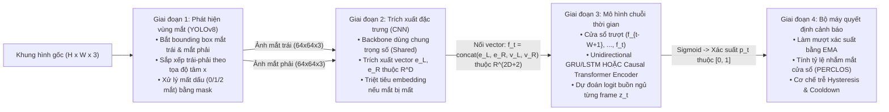

# Thiết Kế Kiến Trúc Hệ Thống — Phát Hiện Tài Xế Buồn Ngủ (`ARCHITECTURE.md`)

## 1. Tổng Quan Luồng Xử Lý End-to-End

Hệ thống phân tích luồng video trực diện tài xế qua 3 giai đoạn học sâu nhân quả (causal) kết hợp 1 bộ máy ra quyết định theo thời gian:



---

## 2. Hợp Đồng Kích Thước Tensor (Tensor Shape Contracts)

Ký hiệu: $B$ = batch size, $T$ = độ dài chuỗi/cửa sổ thời gian (`window_size`), $H_{\text{eye}} = W_{\text{eye}} = 64$ (cấu hình qua YAML), $D$ = chiều embedding của mỗi mắt.

| Giai đoạn | Thành phần | Đầu vào | Đầu ra | Ghi chú |
| :--- | :--- | :--- | :--- | :--- |
| **Stage 1** | `YOLOv8EyeCropper` | Raw frames `(B, T, H, W, 3)` | `eye_crops`: `(B, T, 2, 3, H_eye, W_eye)`<br>`eye_mask`: `(B, T, 2)` | Slot `0` = image-left, Slot `1` = image-right; mắt mất điền `0.0` và `mask=0.0` |
| **Stage 2** | `SharedEyeEncoder` | `eye_crops` flatten -> `(B*T*2, 3, H_eye, W_eye)` | `frame_feats`: `(B, T, 2*D + 2)` | `e = e * mask[..., None]`; ghép `[e_L \|\| e_R \|\| v_L \|\| v_R]` |
| **Stage 3** | `TemporalHead` | `frame_feats`: `(B, T, 2*D + 2)` | `logits`: `(B, T, 1)` | Dự đoán many-to-many nhân quả; không trả về `sigmoid` trong `forward()` |
| **Stage 4** | Decision Engine | `p_t = sigmoid(z_t)` $\in [0, 1]$ | Trạng thái cảnh báo `{ALERT, DROWSY}` | EMA + PERCLOS + Hysteresis/Cooldown |

---

## 3. Chi Tiết Thiết Kế Từng Giai Đoạn

### 3.1 Giai đoạn 1 — `YOLOv8EyeCropper` (`models/`)
* Dùng Ultralytics YOLOv8n/s phát hiện bounding box mắt (và tùy chọn box khuôn mặt để làm mốc phân biệt trái/phải khi chỉ thấy 1 mắt).
* **Quy ước thứ tự không gian:**
  * Khi có `2` mắt: sắp xếp theo tọa độ tâm ngang $c_x$ tăng dần (`slot 0`: $c_x$ nhỏ hơn / bên trái khung hình; `slot 1`: $c_x$ lớn hơn / bên phải khung hình).
  * Khi có `1` mắt: so sánh $c_x$ với tâm khuôn mặt (hoặc $W/2$ nếu không có box mặt) để gán đúng slot `0` hoặc `1`; slot còn lại zero-padding.
  * Khi có `0` mắt: giữ nguyên frame (không drop), điền `0.0` cho cả 2 crop và đặt `eye_mask = [0.0, 0.0]`.

### 3.2 Giai đoạn 2 — `SharedEyeEncoder` (`models/backbone.py`)
* Backbone CNN nhẹ dùng chung trọng số (**custom `ResNet18`** tự cài đặt từ đầu bằng PyTorch, không dùng hàm dựng sẵn từ `torchvision`/`timm`) xử lý đồng thời cả 2 mắt qua batch gộp `(B * T * 2, 3, H_eye, W_eye)` và chiếu về vector embedding chiều $D$ (mặc định $D = 128$).
* Bắt buộc nhân embedding với `eye_mask` sau CNN (`e_L = e_L * v_L`, `e_R = e_R * v_R`) để triệt tiêu vector bias sinh ra từ ảnh `0.0` của mắt bị mất dấu, sau đó mới nối `[v_L, v_R]` thành `f_t` kích thước `2D + 2` (`258` với $D = 128$).

### 3.3 Giai đoạn 3 — `TemporalHead` (`models/temporal.py`)
Hỗ trợ 3 biến thể hoán đổi qua config (`configs/temporal_{gru,lstm,transformer}.yaml`) với cùng giao diện đầu vào `(B, T, 2*D + 2)` và đầu ra `(B, T, 1)`:
* **`CausalGRU` / `CausalLSTM`:** `bidirectional=False`, hỗ trợ nhận và trả về `hidden_state` (`h_n`, `c_n`) qua `forward_with_state()` để suy luận liên tục theo từng frame và reset khi đổi `video_id`/tài xế.
* **`CausalTransformer`:** Thêm Positional Encoding theo bước thời gian, sử dụng `nn.TransformerEncoder` với mặt nạ nhân quả tam giác trên (`-inf` với $j > i$, kết hợp `is_causal=True`) nhằm chặn tuyệt đối rò rỉ thông tin tương lai.

### 3.4 Giai đoạn 4 — Bộ Máy Quyết Định Cảnh Báo (`inference/`)
* **EMA Smoothing:** $\tilde{p}_t = \alpha \cdot p_t + (1 - \alpha) \cdot \tilde{p}_{t-1}$.
* **PERCLOS & Hysteresis:** Kết hợp tỷ lệ frame vượt ngưỡng trong cửa sổ trượt `W` và ngưỡng bật/tắt trễ (`thresh_on > thresh_off`) kèm thời gian `cooldown` để tránh cảnh báo nhấp nháy (flickering).

---

## 4. Cấu Trúc Thư Mục Chuẩn

```text
.
├── AGENTS.md                   # Quy trình vận hành cho AI coding agents
├── ARCHITECTURE.md             # Tài liệu thiết kế kiến trúc (file này)
├── RULES.md                    # Quy chuẩn lập trình & ràng buộc kỹ thuật
├── MEMORY.md                   # Trạng thái dự án, ADRs & nhật ký thực nghiệm
├── configs/                    # File cấu hình YAML (extract.yaml, temporal_gru.yaml, ...)
├── data/                       # Dataset, DataLoader, chia tập theo subject_id
├── models/                     # YOLOv8EyeCropper, SharedEyeEncoder, TemporalHead, pipeline ONNX
├── engine/                     # Huấn luyện (train_temporal.py), đánh giá (evaluate.py)
├── inference/                  # Suy luận thời gian thực (stream_runner.py, tách luồng I/O)
├── tools/                      # Script tiền xử lý & cache đặc trưng (extract_features.py)
└── tests/                      # Unit tests (causality, missing-eye 0/1/2, split leakage, ONNX)
```

---

## 5. Quy Trình Huấn Luyện Theo Bộ Ảnh (`ADR-001` – `ADR-004`) & Suy Luận

### 5.1 Chuẩn Bị Dữ Liệu & Chia Tập Độc Lập Theo Người Lái
* **Định dạng dữ liệu (`ADR-003`):** Dữ liệu không đọc từ file video thô mà từ các bộ ảnh đã trích xuất, quản lý qua `data/labels.csv` (`54` videos: `video_id, label, class_name, num_frames, split`) và `data/frames_manifest.csv` (`41,793` frames: `video_id, frame_idx, label, image_path`), sắp xếp số học tự nhiên tăng dần theo `frame_idx` trong từng `video_id`.
* **Chia tập theo `subject_id` (`ADR-004`):** `video_id` chữ hoa (`A..ZC`) và chữ thường (`a..zc`) thuộc cùng một tài xế (`subject_id = video_id.lower()`). Tập `test` (`7` chủ thể / `14` videos / `10,353` frames) đã được cố định độc lập trong `data/labels.csv`; tập `val` khi huấn luyện chỉ được tách từ pool `split == "train"` (`21` chủ thể / `40` videos / `31,440` frames) theo đúng `subject_id`, tuyệt đối không tách ngẫu nhiên theo frame hoặc làm rò rỉ sang `test`.

### 5.2 Huấn Luyện 2 Pha Theo Từng Bộ Ảnh Của Từng `video_id`
1. **Pha 1 — Stage 1 cố định & Cache Eye Crops (`tools/extract_features.py`):**
   * `YOLOv8EyeCropper` sử dụng weight `models/yolo_best.pt` đã fine-tune (`yolov8n`, `imgsz=320`, `{0: eye, 1: face}`, lấy **top-1 `face`** và **top-2 `eye`** theo confidence).
   * Chạy detector một lần theo đúng thứ tự `frame_idx` của từng `video_id` để lưu cache `(eye_crops, eye_mask)` (hoặc chạy trực tiếp từ ảnh gốc nếu tắt cache), tránh lặp lại chi phí I/O và YOLO qua từng epoch.
2. **Pha 2 — Lấy Mẫu Cửa Sổ Trượt & Huấn Luyện Many-to-One (`engine/train_temporal.py`, `ADR-002`):**
   * **Cửa sổ trượt nội bộ từng video:** `Dataset` gom frame theo đúng `video_id`, giữ nguyên thứ tự `frame_idx` (tuyệt đối không ghép chéo giữa hai `video_id`), lấy mẫu cửa sổ dài `W` bước theo `temporal_stride` (phủ `3–6 giây` lịch sử; tương thích cả video ngắn nhất `109` frame như `g`).
   * **Hàm mất mát Many-to-One:** `TemporalHead` (`CausalGRU` / `CausalLSTM` / `CausalTransformer`) vẫn xuất toàn chuỗi `logits` `(B, W, 1)` theo hợp đồng kiến trúc; vòng lặp train lấy bước cuối `logits[:, -1, :]` `(B, 1)` tính `BCEWithLogitsLoss` (hỗ trợ `pos_weight`) với nhãn mức video `y_clip` $\in \{0, 1\}$.
   * **Fine-tune phối hợp:** Huấn luyện `TemporalHead` với learning rate chính (`temporal_lr`) và đồng thời fine-tune `SharedEyeEncoder` với learning rate nhỏ hơn (`backbone_lr`, hoặc đóng băng CNN khi thử nghiệm nhanh Stage 3).
   * **Chọn mô hình & Đánh giá (`engine/evaluate.py`):** Đánh giá trên `val` theo `Recall`, `Precision`, `F1-Score`, `AUROC` (mức window và tổng hợp mức `video_id`), lưu `best.pt` và chỉ chạy đánh giá cuối cùng trên `split == "test"` sau khi chốt mô hình.

### 5.3 Suy Luận Thời Gian Thực (`inference/stream_runner.py`)
* Luồng Producer (Camera I/O) đẩy frame mới nhất vào hàng đợi `maxsize=1` (ghi đè frame cũ).
* Luồng Consumer (Compute) chạy Stage 1–2 trên đúng `1` frame hiện tại, đẩy $f_t$ vào `collections.deque(maxlen=W)` (hoặc cập nhật `hidden_state` của GRU/LSTM), chạy Stage 3 + Stage 4 (đọc `sigmoid(logits[:, -1, :])`), và log `ms/frame` cùng `FPS`.
